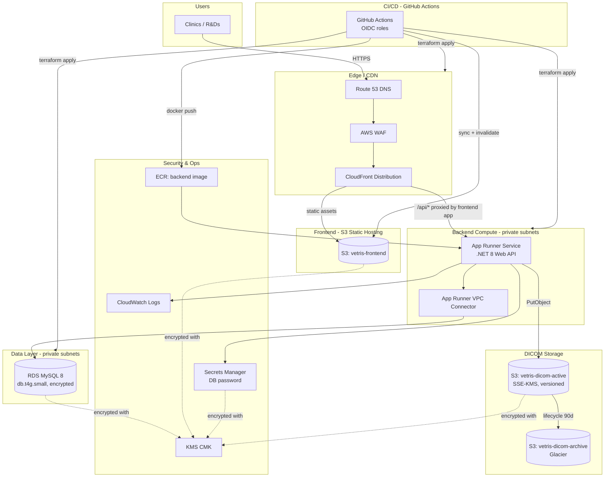

# VetRIS-Scaffold

A minimal, HIPAA-eligible-services-only scaffold for a teleradiology application:
**React 18 + Vite** frontend, **.NET 8 Web API** backend, **MySQL 8 (RDS)** database,
DICOM file storage on **S3**, all deployed to AWS with **Terraform** and **GitHub
Actions (OIDC)**.

This repo intentionally contains almost no business logic — just health checks,
basic CRUD for a `Study` entity, and a file-upload path to S3. It exists to give
you a working, secure, deployable skeleton to build the real VetRIS application on top of.

> ⚠️ **This is a scaffold, not a compliant system by itself.** Using
> HIPAA-eligible AWS services is necessary but not sufficient for HIPAA
> compliance. See the [HIPAA Checklist](#hipaa-checklist) — a signed AWS BAA,
> your own access controls, audit procedures, workforce training, and a risk
> assessment are all still required.

---

## Table of Contents

1. [Architecture](#architecture)
2. [Repository Structure](#repository-structure)
3. [Prerequisites](#prerequisites)
4. [Deployment Guide](#deployment-guide)
5. [Local Development](#local-development)
6. [CI/CD Pipelines](#cicd-pipelines)
7. [Cost Breakdown (~100 users)](#cost-breakdown-100-users)
8. [Scaling Plan](#scaling-plan)
9. [HIPAA Checklist](#hipaa-checklist)

---

## Architecture



**Request flow:** Clinic → Route53 → WAF → CloudFront → (static React app from S3,
or API calls proxied to the App Runner backend) → App Runner (private VPC connector)
→ RDS MySQL / S3 DICOM buckets.

**Key HIPAA-relevant design choices:**
- All data stores (RDS, S3, Secrets Manager, CloudWatch Logs) encrypted at rest with a single customer-managed KMS key.
- RDS and backend compute live in **private subnets** with no direct internet route (outbound only via NAT).
- TLS enforced everywhere: CloudFront (HTTPS-only), RDS (`require_secure_transport=1`), S3 bucket policies deny non-HTTPS requests.
- S3 access logging + CloudFront access logging to a dedicated logs bucket.
- WAF (managed rule groups + rate limiting) in front of CloudFront.
- No long-lived AWS credentials anywhere — CI/CD uses GitHub OIDC → short-lived STS tokens, scoped to 3 separate least-privilege IAM roles.

---

## Repository Structure

```
vetris-scaffold/
├── frontend/                  # React 18 + Vite SPA
│   ├── src/
│   │   ├── api/client.js      # Axios client (VITE_API_URL)
│   │   └── pages/             # Login, Dashboard, UploadDicom
│   ├── Dockerfile             # multi-stage: node build -> nginx serve
│   └── nginx.conf
├── backend/
│   └── VetRIS.Api/            # .NET 8 Web API
│       ├── Controllers/       # HealthController, StudiesController
│       ├── Models/Study.cs
│       ├── Data/VetrisDbContext.cs   # EF Core + Pomelo.MySql
│       ├── Services/S3UploadService.cs
│       └── Program.cs
│   └── Dockerfile
├── db/init.sql                # local-dev-only schema bootstrap
├── docker-compose.yml         # local dev: mysql + backend + frontend
├── terraform/
│   ├── bootstrap/             # one-time: creates the TF state S3 bucket + DynamoDB lock table
│   ├── envs/dev/              # root module for the "dev" environment
│   └── modules/
│       ├── network/           # VPC, subnets, NAT, security groups
│       ├── security/          # KMS, CloudWatch Logs, WAF, Secrets Manager
│       ├── storage/           # S3 DICOM active/archive buckets
│       ├── database/          # RDS MySQL
│       ├── backend/           # ECR + App Runner (ECS Fargate alt. commented)
│       ├── frontend/          # S3 + CloudFront + ACM + Route53
│       └── iam-oidc/          # GitHub OIDC provider + 3 CI/CD roles
└── .github/workflows/
    ├── infra-deploy.yml       # terraform plan/apply on /terraform changes
    ├── backend-deploy.yml     # build+push ECR, deploy App Runner on /backend changes
    └── frontend-deploy.yml    # npm build, S3 sync, CloudFront invalidation on /frontend changes
```

---

## Prerequisites

- **AWS Account** with administrator access for the initial bootstrap.
- **A signed AWS Business Associate Addendum (BAA)** — required before any real
  PHI touches these services. Request it via AWS Artifact.
- **A registered domain** (e.g. `{{YOUR_DOMAIN}}`) with an existing **Route 53
  hosted zone** in the target AWS account.
- **GitHub repository** (this repo, pushed to your own org/account) with admin
  access to configure Environments and secrets.
- Locally: Terraform >= 1.7, AWS CLI v2, Docker, Node 20, .NET 8 SDK (only needed
  for local dev, not for deployment).

---

## Deployment Guide

### Step 1: Bootstrap Terraform State + GitHub OIDC trust

The `terraform/envs/dev` root module uses an S3 backend that must already exist,
and the CI/CD roles need to trust *your* GitHub repo. Do this once, from your
local machine, using your own (temporary, admin) AWS credentials:

```bash
cd terraform/bootstrap
terraform init
terraform apply \
  -var="state_bucket_name=vetris-tfstate-{{YOUR_ACCOUNT_ID}}" \
  -var="lock_table_name=vetris-tf-locks"
```

Note the `state_bucket_arn` and `lock_table_arn` outputs — you'll need them next.

Fill in `terraform/envs/dev/backend.tf`:

```hcl
backend "s3" {
  bucket         = "vetris-tfstate-{{YOUR_ACCOUNT_ID}}"
  key            = "vetris/dev/terraform.tfstate"
  region         = "us-east-1"
  dynamodb_table = "vetris-tf-locks"
  encrypt        = true
}
```

### Step 2: `terraform init` / `apply`

```bash
cd terraform/envs/dev
cp terraform.tfvars.example terraform.tfvars
# edit terraform.tfvars: domain_name, route53_zone_id, github_org, github_repo,
# tf_state_bucket_arn, tf_lock_table_arn

terraform init
terraform plan -var-file=terraform.tfvars
terraform apply -var-file=terraform.tfvars
```

This provisions the VPC, RDS, S3 buckets, ECR repo, App Runner service (with a
placeholder image until Step 3), CloudFront + ACM + Route53, WAF, KMS, Secrets
Manager, and the 3 GitHub OIDC IAM roles.

Grab the outputs you'll need for CI/CD secrets:

```bash
terraform output
# ecr_repository_url, backend_api_url, cloudfront_distribution_id,
# infra_cicd_role_arn, backend_cicd_role_arn, frontend_cicd_role_arn
```

### Step 3: First manual backend deploy

App Runner is created pointing at an image tag (`:latest`) that doesn't exist
yet, so push one manually before CI/CD takes over:

```bash
cd backend
aws ecr get-login-password --region us-east-1 | \
  docker login --username AWS --password-stdin <ecr_repository_url>

docker build -t vetris-backend .
docker tag vetris-backend:latest <ecr_repository_url>:latest
docker push <ecr_repository_url>:latest

aws apprunner start-deployment --service-arn <app_runner_service_arn>
```

Confirm it's healthy:

```bash
curl https://<backend_api_url>/api/health
```

### Step 4: Configure GitHub secrets

Create three **GitHub Environments** — `dev-infra`, `dev-backend`, `dev-frontend`
(Settings → Environments) — each with its own `AWS_ROLE_ARN` secret pointing at
the matching Terraform output:

| Environment    | Secret          | Value                             |
|----------------|-----------------|------------------------------------|
| `dev-infra`    | `AWS_ROLE_ARN`  | `infra_cicd_role_arn` output       |
| `dev-backend`  | `AWS_ROLE_ARN`  | `backend_cicd_role_arn` output     |
| `dev-backend`  | `APP_RUNNER_SERVICE_ARN` | App Runner service ARN    |
| `dev-frontend` | `AWS_ROLE_ARN`  | `frontend_cicd_role_arn` output    |
| `dev-frontend` | `FRONTEND_BUCKET_NAME`   | `frontend_bucket_name` output |
| `dev-frontend` | `CLOUDFRONT_DISTRIBUTION_ID` | `cloudfront_distribution_id` output |
| `dev-frontend` | `BACKEND_API_URL` | `https://<backend_api_url>`      |

(Optional but recommended: add required reviewers to `dev-infra` so `terraform
apply` needs manual approval.)

### Step 5: Push code to trigger CI/CD

```bash
git add .
git commit -m "Initial VetRIS-Scaffold"
git push origin main
```

- Changes under `terraform/**` → `infra-deploy.yml` runs `plan` (PRs) / `apply` (main).
- Changes under `backend/**` → `backend-deploy.yml` builds, pushes to ECR, deploys App Runner.
- Changes under `frontend/**` → `frontend-deploy.yml` builds, syncs to S3, invalidates CloudFront.

Visit `https://{{YOUR_DOMAIN}}` (the `domain_name` you configured).

---

## Local Development

```bash
cp frontend/.env.example frontend/.env
docker compose up --build
```

- Frontend: http://localhost:5173
- Backend: http://localhost:8080/api/health
- MySQL: localhost:3306 (`root` / `devpassword`)

The backend needs AWS credentials with S3 access to exercise the upload path
locally (export `AWS_ACCESS_KEY_ID` / `AWS_SECRET_ACCESS_KEY` / `AWS_REGION`
before `docker compose up`, or point `Aws__DicomActiveBucket` at a bucket you
own for testing).

---

## CI/CD Pipelines

| Workflow              | Trigger                | What it does                                                       | AWS Role       |
|------------------------|-------------------------|----------------------------------------------------------------------|-----------------|
| `infra-deploy.yml`     | push/PR to `terraform/**` | `terraform fmt/validate/plan` on PRs; `plan` + `apply` on `main`   | `dev-infra` role |
| `backend-deploy.yml`   | push to `backend/**`     | Docker build → ECR push → `apprunner start-deployment`             | `dev-backend` role |
| `frontend-deploy.yml`  | push to `frontend/**`    | `npm run build` → `aws s3 sync` → CloudFront invalidation           | `dev-frontend` role |

All three authenticate via **GitHub OIDC** (`aws-actions/configure-aws-credentials`)
— no static AWS access keys are stored in GitHub at any point.

---

## Cost Breakdown (~100 users)

Rough monthly estimate for a low-to-moderate traffic **dev/staging-sized**
deployment (single AZ, single NAT gateway, `db.t4g.small`, App Runner min=1/max=5).
Actual costs vary by region, data volume, and usage patterns — treat this as
a planning estimate, not a quote.

| Component                              | Est. Monthly Cost (USD) | Notes |
|-----------------------------------------|--------------------------|-------|
| RDS MySQL `db.t4g.small` (single-AZ, 50GB gp3) | ~$55–70 | + ~$0.023/GB-mo for backups beyond free tier |
| App Runner (1 vCPU / 2GB, ~1 avg instance) | ~$50–90 | Scales with request volume / active instance-hours |
| NAT Gateway (1x) | ~$32 + data processing | $0.045/hr + $0.045/GB processed |
| S3 (active + archive + logs + frontend), ~50GB active | ~$5–15 | Glacier archive is much cheaper per GB |
| CloudFront (moderate traffic, ~50GB/mo) | ~$5–10 | PriceClass_100 (US/EU only) |
| WAF (WebACL + 3 rules + requests) | ~$6–10 | $5/mo base + $1/rule + $0.60/1M requests |
| KMS (1 CMK + requests) | ~$1–3 | $1/mo/key + $0.03/10k requests |
| Secrets Manager (1 secret) | ~$0.40 | |
| CloudWatch Logs (90-day retention, moderate volume) | ~$5–15 | Ingestion + storage |
| Route 53 (hosted zone + queries) | ~$1–2 | |
| ECR (image storage) | ~$1–2 | |
| **Estimated total** | **~$160–250/mo** | |

**Cost levers:** the NAT Gateway and RDS instance are the two largest fixed
costs. For dev environments, consider stopping RDS outside business hours,
and using a NAT instance instead of NAT Gateway for non-prod.

---

## Scaling Plan

This scaffold is deliberately small. As real usage grows:

1. **RDS read replica(s)** — add read replicas for reporting/dashboard queries
   once write load and read load start competing; promote to Multi-AZ (`multi_az = true`)
   for production availability before adding replicas.
2. **App Runner max instances** — raise `max_size` in
   `terraform/modules/backend` (`aws_apprunner_auto_scaling_configuration_version`)
   as concurrent request volume grows; App Runner scales automatically between
   `min_size`/`max_size` based on concurrent requests per instance.
3. **Move to ECS Fargate** (alternative module already stubbed in
   `terraform/modules/backend/main.tf`, commented) if you need: WAF directly in
   front of the API, Fargate Spot for cost savings, or an internal-only ALB for
   service-to-service calls.
4. **S3 + CloudFront CDN** — already in place for the frontend; extend
   CloudFront caching to versioned/immutable API responses if read-heavy
   endpoints emerge (e.g. thumbnails).
5. **WAF** — tune managed rule groups and rate-based rules as real traffic
   patterns are observed; consider adding AWS Shield Advanced for DDoS
   protection at higher traffic tiers.
6. **Multi-AZ NAT** — add one NAT Gateway per AZ (currently single NAT) once
   availability requirements exceed single-AZ egress risk.
7. **Database sharding/partitioning** — if `Studies` grows very large,
   partition by date or archive old rows to a cold-storage table/S3 (Parquet)
   ahead of RDS storage limits.
8. **Async processing** — introduce SQS + a worker service for DICOM
   processing/validation once uploads need more than a synchronous S3 PUT
   (e.g. virus scanning, metadata extraction, thumbnail generation).

---

## HIPAA Checklist

Using HIPAA-eligible AWS services is necessary but **not sufficient**. Before
handling real PHI:

- [ ] **Signed BAA** with AWS covering every service in use (RDS, S3, App Runner,
      CloudFront, KMS, Secrets Manager, CloudWatch, WAF, ECR — confirm current
      HIPAA-eligible service list on AWS's compliance page, as it changes).
- [ ] **Encryption at rest** everywhere PHI can land — done in this scaffold via
      one CMK across RDS/S3/Secrets Manager/CloudWatch Logs.
- [ ] **Encryption in transit** — done via CloudFront HTTPS-only, RDS
      `require_secure_transport`, S3 TLS-only bucket policies. Verify your own
      application code never disables certificate validation.
- [ ] **Access logging & audit trail** — S3 access logs, CloudFront logs,
      CloudWatch Logs for RDS (`error`, `general`, `slowquery`) and the backend
      app are enabled. Add **CloudTrail** (not included here) for full AWS API
      audit logging, and application-level audit logs for who accessed which
      patient's study.
- [ ] **Authentication & authorization** — this scaffold's `Login` page is a
      placeholder with no real auth. Add a real IdP (Cognito, Okta, Auth0) with
      MFA before production, and enforce authorization on every API endpoint
      (currently none is enforced).
- [ ] **Minimum necessary access / least privilege IAM** — the 3 CI/CD roles
      and the App Runner task role are scoped down; review and tighten further
      per your org's policies, especially the infra role's broad `*` actions.
- [ ] **Backup & disaster recovery** — RDS automated backups (7-day retention)
      and S3 versioning are enabled. Define and test an actual DR runbook and
      RTO/RPO targets.
- [ ] **Data retention & disposal** — define retention periods for DICOM
      studies and ensure the Glacier lifecycle policy matches your legal/
      regulatory retention requirements (this scaffold uses 90 days as a
      placeholder).
- [ ] **Workforce training & policies** — technical controls alone don't
      satisfy the HIPAA Security Rule's administrative safeguards; you need
      documented policies, workforce training, and incident response procedures.
- [ ] **Risk assessment** — perform a formal HIPAA Security Risk Assessment
      covering this architecture before go-live, and periodically thereafter.
- [ ] **Business Associate Agreements with any other vendors** in your stack
      (monitoring, error tracking, email, etc.) that could touch PHI.

---

## Placeholders to Replace

Search the repo for these and fill in your own values before deploying:

- `{{YOUR_DOMAIN}}` — your registered domain
- `{{YOUR_ACCOUNT_ID}}` — your AWS account ID
- `{{YOUR_GITHUB_ORG}}` — your GitHub org/username
- `{{YOUR_TF_STATE_BUCKET}}` / `{{YOUR_TF_LOCK_TABLE}}` — from the bootstrap step
- `{{YOUR_ROUTE53_ZONE_ID}}` — your existing hosted zone ID
